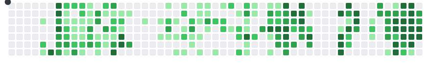

<div align="center">

# *Hi, I'm dmechai*

### <ins><sup>ABOUT ME</sup></ins>

**待填写**：写一两句话介绍自己，或写下你最近在做什么。

### <sup>LET'S CONNECT!</sup>

<!-- contact:start -->
[](https://github.com/dmechai)
[](https://github.com/dmechai?tab=repositories)

**待填写（可选）**：添加网站、邮箱或社交链接。
<!-- contact:end -->

<br>

---

<br>

<!-- tech-stack:start -->
### <ins><sup>MY TECH STACK</sup></ins>

**待填写**：列出常用技术，可按语言、前端、后端或工具分组。
<!-- tech-stack:end -->

<br>

---

<br>

<!-- fun-facts:start -->

### <ins><sup>FUN FACTS</sup></ins>

<sub>All commits reachable from current branches, counted once per repository.</sub>

```text
Sunday     190 commits  ██░░░░░░░░░░░░░░░░░░   11.7%
Monday     258 commits  ███░░░░░░░░░░░░░░░░░   15.8%
Tuesday    249 commits  ███░░░░░░░░░░░░░░░░░   15.3%
Wednesday  275 commits  ███░░░░░░░░░░░░░░░░░   16.9%
Thursday   271 commits  ███░░░░░░░░░░░░░░░░░   16.6%
Friday     281 commits  ███░░░░░░░░░░░░░░░░░   17.3%
Saturday   104 commits  █░░░░░░░░░░░░░░░░░░░    6.4%
```

<sub>GitHub-detected primary languages.</sub>

```text
Python        9 repos  ████████████░░░░░░░░   60.0%
Shell         2 repos  ███░░░░░░░░░░░░░░░░░   13.3%
Go             1 repo  █░░░░░░░░░░░░░░░░░░░    6.7%
HTML           1 repo  █░░░░░░░░░░░░░░░░░░░    6.7%
JavaScript     1 repo  █░░░░░░░░░░░░░░░░░░░    6.7%
TypeScript     1 repo  █░░░░░░░░░░░░░░░░░░░    6.7%
```

<!-- fun-facts:end -->

<br>

---

<br>

<!-- featured-projects:start -->
### <ins><sup>FEATURED PROJECTS</sup></ins>

**待选择**：选几个项目，填上名称、链接和一句简介。
<!-- featured-projects:end -->

<br>

---

<br>

<!-- snake:start -->
### <ins><sup>CONTRIBUTION ACTIVITY</sup></ins>

<picture>
  <source media="(prefers-color-scheme: dark)" srcset="assets/snake-dark.svg">
  
</picture>
<!-- snake:end -->

</div>
