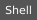

<div align="center">

# *Hi, I'm dmechai*

### <ins><sup>ABOUT ME</sup></ins>

请你一言不发，穿过这片沼泽。

### <sup>LET'S CONNECT!</sup>

Visit [my website](https://dmechai.com/) or connect with me on:

<!-- contact:start -->
[](https://github.com/dmechai)
[](mailto:hey.dmechai@gmail.com)
[](https://x.com/0xdmechai)
<!-- contact:end -->

<!-- tech-stack:start -->
<!-- tech-stack:end -->

<!-- fun-facts:start -->

### <ins><sup>FUN FACTS</sup></ins>

<sub>All commits reachable from current branches, counted once per repository.</sub>

```text
Sunday     190 commits  ██░░░░░░░░░░░░░░░░░░   11.7%
Monday     258 commits  ███░░░░░░░░░░░░░░░░░   15.8%
Tuesday    249 commits  ███░░░░░░░░░░░░░░░░░   15.3%
Wednesday  275 commits  ███░░░░░░░░░░░░░░░░░   16.9%
Thursday   265 commits  ███░░░░░░░░░░░░░░░░░   16.3%
Friday     287 commits  ████░░░░░░░░░░░░░░░░   17.6%
Saturday   104 commits  █░░░░░░░░░░░░░░░░░░░    6.4%
```

<sub>GitHub-detected languages.</sub>

```text
Python       13 repos  ██████████████░░░░░░   72.2%
Shell        12 repos  █████████████░░░░░░░   66.7%
HTML         10 repos  ███████████░░░░░░░░░   55.6%
JavaScript    9 repos  ██████████░░░░░░░░░░   50.0%
CSS           7 repos  ████████░░░░░░░░░░░░   38.9%
Dockerfile    7 repos  ████████░░░░░░░░░░░░   38.9%
TypeScript    3 repos  ███░░░░░░░░░░░░░░░░░   16.7%
Go            2 repos  ██░░░░░░░░░░░░░░░░░░   11.1%
Swift         2 repos  ██░░░░░░░░░░░░░░░░░░   11.1%
Astro          1 repo  █░░░░░░░░░░░░░░░░░░░    5.6%
```

<details>
<summary>11 more languages</summary>

```text
Java              1 repo  ██░░░░░░░░░░░░░░░░░░    7.7%
Kotlin            1 repo  ██░░░░░░░░░░░░░░░░░░    7.7%
Makefile          1 repo  ██░░░░░░░░░░░░░░░░░░    7.7%
NSIS              1 repo  ██░░░░░░░░░░░░░░░░░░    7.7%
Objective-C       1 repo  ██░░░░░░░░░░░░░░░░░░    7.7%
Objective-C++     1 repo  ██░░░░░░░░░░░░░░░░░░    7.7%
PowerShell        1 repo  ██░░░░░░░░░░░░░░░░░░    7.7%
PureBasic         1 repo  ██░░░░░░░░░░░░░░░░░░    7.7%
Ruby              1 repo  ██░░░░░░░░░░░░░░░░░░    7.7%
SCSS              1 repo  ██░░░░░░░░░░░░░░░░░░    7.7%
Vue               1 repo  ██░░░░░░░░░░░░░░░░░░    7.7%
```

</details>

<!-- fun-facts:end -->

<!-- featured-projects:start -->

### <ins><sup>FEATURED PROJECTS</sup></ins>

<div align="left">
<table>
<tbody>
<tr>
<td width="50%" align="left" valign="top"><strong><a href="https://github.com/dmechai/newvps">newvps</a></strong><br><sub>Ubuntu / Debian 新 VPS 的交互式初始化脚本，配置系统更新、防火墙和 fail2ban。</sub>
<br><br></td>
<td width="50%" align="left" valign="top"><strong><a href="https://github.com/dmechai/oriel-nft">oriel-nft</a></strong><br><sub>Oriel NFT is a self-hosted AI art studio for creating coherent NFT collections from a reference image.</sub>
<br><sub>•&nbsp; Explore art directions from a reference image and lock in a consistent style.</sub>
<br><sub>•&nbsp; Export generated images, NFT metadata, and rarity statistics.</sub>
<br><br> </td>
</tr>
</tbody>
<tbody>
<tr>
<td width="50%" align="left" valign="top"><strong><a href="https://github.com/dmechai/dmechai">dmechai</a></strong><br><sub>GitHub profile README with project highlights, activity charts, and a contribution snake.</sub>
<br><sub>•&nbsp; Public projects ranked by stars and forks.</sub>
<br><sub>•&nbsp; Commit and language charts, plus a light and dark contribution snake.</sub>
<br><br>  </td>
</tr>
</tbody>
</table>
</div>

<!-- featured-projects:end -->

<!-- snake:start -->
### <ins><sup>CONTRIBUTION ACTIVITY</sup></ins>

<picture>
  <source media="(prefers-color-scheme: dark)" srcset="assets/snake-dark.svg">
  
</picture>
<!-- snake:end -->

</div>
